

<picture>
  <source media="(prefers-color-scheme: dark)" srcset="assets/hero-dark.svg">
  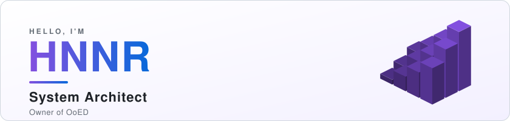
</picture>

## Skills

<picture><source media="(prefers-color-scheme: dark)" srcset="https://cdn.simpleicons.org/openjdk/e6edf3"></picture>&nbsp;&nbsp;&nbsp;&nbsp;&nbsp;&nbsp;&nbsp;&nbsp;&nbsp;&nbsp;&nbsp;&nbsp;

<picture>
  <source media="(prefers-color-scheme: dark)" srcset="assets/skills-dark.svg">
  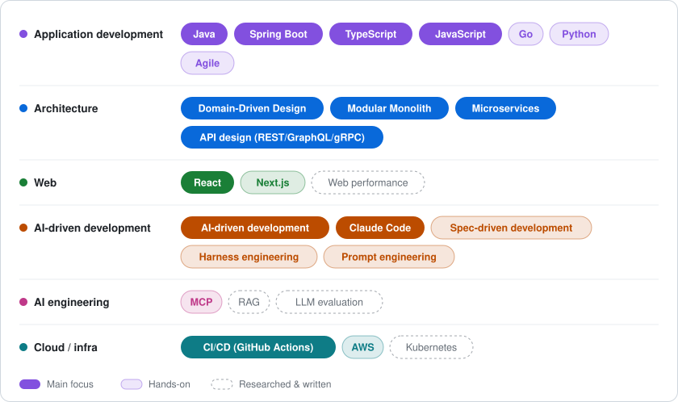
</picture>

Source: [oortedge.com/author](https://www.oortedge.com/author)

## Contributions

<picture>
  <source media="(prefers-color-scheme: dark)" srcset="assets/stats-dark.svg">
  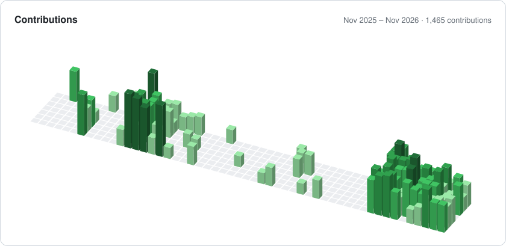
</picture>

## Favorite repositories

<table>
<tr><td width="50%"><a href="https://github.com/public-apis/public-apis"><picture><source media="(prefers-color-scheme: dark)" srcset="assets/repos/0-dark.svg">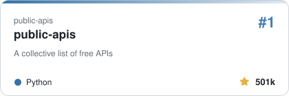</picture></a></td><td width="50%"><a href="https://github.com/freeCodeCamp/freeCodeCamp"><picture><source media="(prefers-color-scheme: dark)" srcset="assets/repos/1-dark.svg">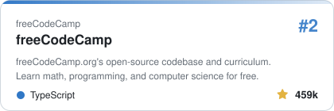</picture></a></td></tr>
<tr><td width="50%"><a href="https://github.com/EbookFoundation/free-programming-books"><picture><source media="(prefers-color-scheme: dark)" srcset="assets/repos/2-dark.svg">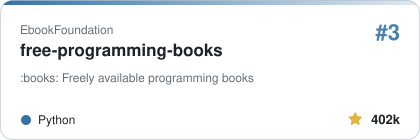</picture></a></td><td width="50%"><a href="https://github.com/affaan-m/ECC"><picture><source media="(prefers-color-scheme: dark)" srcset="assets/repos/3-dark.svg">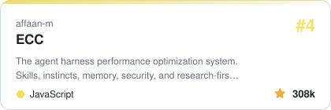</picture></a></td></tr>
<tr><td width="50%"><a href="https://github.com/react/react"><picture><source media="(prefers-color-scheme: dark)" srcset="assets/repos/4-dark.svg">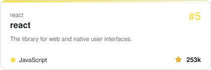</picture></a></td><td width="50%"><a href="https://github.com/microsoft/vscode"><picture><source media="(prefers-color-scheme: dark)" srcset="assets/repos/5-dark.svg">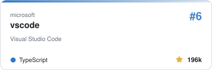</picture></a></td></tr>
<tr><td width="50%"><a href="https://github.com/ollama/ollama"><picture><source media="(prefers-color-scheme: dark)" srcset="assets/repos/6-dark.svg">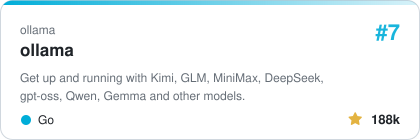</picture></a></td><td width="50%"><a href="https://github.com/getify/You-Dont-Know-JS"><picture><source media="(prefers-color-scheme: dark)" srcset="assets/repos/7-dark.svg">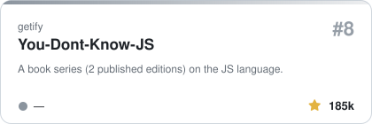</picture></a></td></tr>
</table>
